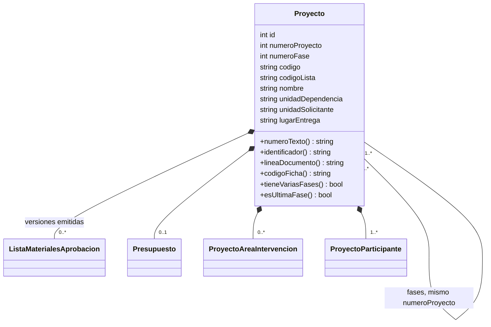

# Revisión con el Ing. de DTIC del 2026-11-05: ficha del proyecto, fases y documentos

Resumen para el tutor de lo que cambió en el sistema por la revisión del 2026-11-05, implementado del
2026-11-05 al 2026-11-06 (PR #43 a #50). Acta de la reunión: `Escritorio\archivos guia\A1\acuerdos_revision_ficha_proyecto.md`.

## La idea central

> "El proyecto es una ENTIDAD (un registro), no un documento." (punto 1 del acta)

Antes, el proyecto llevaba un código de gestión documental (`RD-PI-PT-028`) y cada fase era un proyecto
nuevo con su propio código. Ahora:

- El **proyecto** tiene un **número** correlativo (001, 002…) que comparten **todas sus fases**.
- El código **PT** es de la **ficha técnica del proyecto**, que es **una por proyecto**, con un bloque
  por fase.
- Cada **fase** tiene su propia área de intervención, su equipo y su carpeta económica (lista de
  materiales, especificaciones, cotizaciones y presupuesto).

## Qué cambió, por partes

| Parte | PR | Qué cambió |
|---|---|---|
| 1 | #43 | La versión se escribe **1.0, 1.1…** (antes 01, 02) en todos los documentos. Área de intervención en **una línea por edificio**. El presupuesto y la lista ya no llevan unidad ni área. Formulario ET en letra 11. |
| 2 | #44 | La **lista de materiales no se aprueba** (solo "Elaborado por") y tiene **código propio `RD-PI-LM-NNN`**. |
| 3 | #45 | El **lugar de entrega es de cada especificación**, escrito en la fila de la lista; cambiarlo reemite el formulario. El del proyecto queda como "por defecto" y sale de la ficha. |
| 4 | #46 | La **ficha técnica es un documento normado**: cabecera del lineamiento, orden datos → unidades → fechas → área → equipo → documentos, control de elaboración, BORRADOR hasta aprobarse. El tipo PT se llama "Fichas técnicas del proyecto". |
| 5a | #47 | **Número de proyecto** (`numeroProyecto`), común a todas las fases. |
| 5b | #48 | **"Agregar fase"**: solo en la última fase y con su presupuesto aprobado. Los datos del proyecto no cambian en las fases siguientes. |
| 5c | #49 | Línea única del proyecto en los documentos: `PROYECTO: 001 – NOMBRE EN MAYÚSCULAS (FASE n)`. |
| 5d | #50 | **Una sola ficha técnica por proyecto**, con un bloque por fase y la versión calculada (1.0, 1.1…). |
| 5f | — | **Varias fases a la vez** (Ing. de DTIC, 2026-11-09): "Agregar fase" ya no exige la fase anterior aprobada. Los datos del proyecto se copian de la fase 1 a las demás; la versión de la ficha técnica sigue el orden de aprobación. |

## Modelo de datos (diagrama de clases)

Se eligió **no crear una tabla nueva** para la fase (opción 1, decidida con el desarrollador el
2026-11-06): **cada fila de `redes.Proyecto` es una FASE** y `numeroProyecto` agrupa las fases de un
mismo proyecto. Así toda la carpeta económica, que ya colgaba de `Proyecto`, siguió funcionando sin
cambios.

### Atributos nuevos o que cambiaron de significado

| Clase | Atributo | Antes | Ahora |
|---|---|---|---|
| Proyecto | `numeroProyecto` (nuevo) | — | Número del proyecto, el **mismo en todas sus fases**; único junto con `numeroFase` |
| Proyecto | `numeroFase` | Fase de un proyecto encadenado | Igual, ordena las fases de un mismo número |
| Proyecto | `codigo` | Código del proyecto `RD-PI-PT-NNN` | Código de la **ficha técnica**; solo la fase 1 lo tiene (NULL en las fases 2+) |
| Proyecto | `codigoLista` (nuevo) | — | Código de la lista de materiales `RD-<proceso>-LM-NNN`, uno por fase |
| Proyecto | `lugarEntrega` | Lugar de entrega del proyecto | "Lugar de entrega por defecto": lo toma una especificación si en la lista no se escribe otro |
| Presupuesto | `areaIntervencion` | Se pedía al enviar a revisión | Ya no se pide ni se imprime (queda lo de los presupuestos de antes) |
| ListaMaterialesAprobacion | (toda la clase) | Versión **aprobada** de la lista | Versión **emitida** (enviada a cotización); `fechaAprobacion` = fecha del envío. Conserva el nombre de la tabla |
| CorrelativoDocumento | `tipo` | PT, PR, ET | **NP** (número de proyecto), PT, **LM**, PR, ET |
| EspecificacionEmision | `lugarEntrega` | Copiado del proyecto | El de la fila de la lista (vacío = el del proyecto) |

### Relaciones

- **Proyecto (fase) → sus fases hermanas**: nueva asociación por `numeroProyecto` (`Proyecto::$fases`,
  todas las filas con el mismo número, ordenadas por `numeroFase`). La auto-relación
  `idProyectoAnterior` (0..1) se mantiene: la fase 2 apunta a la 1.
- Sin cambios: Proyecto ◆— ProyectoItem, Presupuesto, ProyectoAreaIntervencion, ProyectoParticipante,
  ListaMaterialesAprobacion… (todo sigue colgando de la fila de la fase).

`codigo` = código de la ficha (solo fase 1); `numeroTexto()` = "001"; `identificador()` = "Proyecto 001 · Fase 2";
`lineaDocumento()` = "PROYECTO: 001 – NOMBRE (FASE 2)".

**Datos del proyecto** (iguales en todas las fases, `Proyecto::ATRIBUTOS_COMUNES`): nombre, descripción,
tipo, proceso, unidad / dependencia y unidad solicitante. **Datos de cada fase**: área de intervención,
equipo, lugar de entrega por defecto, lista, especificaciones, cotizaciones y presupuesto.

### Migraciones

| Migración | Qué hace |
|---|---|
| `m261106_030000_codigo_lista_materiales` | Tipo LM en el correlativo, `Proyecto.codigoLista`, numera las listas existentes |
| `m261106_120000_numero_de_proyecto` | Tipo NP, `Proyecto.numeroProyecto`; cada cadena de fases recibe un número en orden de creación |
| `m261106_150000_una_ficha_por_proyecto` | Quita el PT de las fases 2+ y lo anota en su historial (el número no se reutiliza) |

## Reglas de negocio nuevas

1. **Número de proyecto**: lo asigna el sistema (correlativo NP). Un proyecto nuevo toma el siguiente;
   una fase siguiente, el de la anterior. Se escribe "001" (un solo lugar: `Proyecto::numeroTexto()`).
2. **Agregar fase**: desde la **última** fase del proyecto, esté o no aprobada: **varias fases pueden
   elaborarse a la vez** (dicho por el Ing. de DTIC el 2026-11-09; del 06 al 09-11 se exigía la anterior
   aprobada). Una fase aprobada nunca se modifica; "reabrir" un proyecto aprobado es agregarle una fase.
   No se repite una fase dentro del proyecto.
3. **Datos del proyecto**: se escriben solo en la fase 1; en una fase 2+ se muestran deshabilitados y el
   servidor los toma siempre de la fase anterior. Como la fase 1 puede editarse cuando ya existen las
   siguientes, al guardarla sus datos se **copian a las demás fases** (cada una lo anota en su
   historial). Quedan fijos también en la fase 1 cuando **otra fase ya está aprobada**.
4. **Ficha técnica del proyecto**: una por proyecto (código PT de la fase 1). Cada fase aprobada es una
   versión (1.0, 1.1…), contadas en el **orden en que se aprobaron**; mientras **alguna** fase tenga su
   presupuesto sin aprobar, la ficha técnica del proyecto es la versión siguiente en BORRADOR (una fase
   con presupuesto cancelado no cuenta). Aprobada = fecha y firmas del presupuesto aprobado más reciente.
   La versión **se calcula**, no se guarda.
5. **Lista de materiales**: no se aprueba; "Enviar a cotización" emite la versión siguiente.
6. **Lugar de entrega**: por especificación; cambiarlo en un formulario ya emitido lo reemite
   (mismo código, versión siguiente).
7. **Fase única**: no se muestra "Fase" en ningún lado ("no poner Fase 1, porque da a entender que hay
   fase 2").

## Casos de uso

| Caso de uso | Cambio |
|---|---|
| Registrar proyecto | Asigna el número de proyecto, el código de la ficha y el de la lista. Ya no se elige "fase anterior" |
| **Agregar fase** (nuevo; reemplaza "Crear fase siguiente") | Extiende *Consultar proyecto* y *Elaborar presupuesto*: desde la última fase, aprobada o no (varias fases a la vez) |
| Imprimir ficha técnica del proyecto | Pasa a ser un documento normado, uno por proyecto, con todas sus fases |
| Elaborar lista de ítems | Incluye el lugar de entrega de cada especificación |
| Enviar lista a cotización | Emite (ya no aprueba) la versión de la lista |

## Diagramas de secuencia y actividades

- **Registrar proyecto**: termina con tres números del correlativo (NP, PT, LM); una fase siguiente
  solo toma LM.
- **Guardar lista**: si cambió el lugar de entrega de un formulario emitido, se reemite
  (`ListaItemsService::reemitirPorCambio()`), en la misma transacción.
- **Actividades del proyecto**: después de *Aprobar presupuesto* aparece la decisión *¿agregar otra
  fase?* → *Agregar fase* → vuelve a *Elaborar lista de ítems* con la fase nueva. La ficha pasa de
  "versión n aprobada" a "versión n+1 borrador".

## Lo que sigue pendiente (Ing. de DTIC)

- Formato del número de proyecto: solo entero o con prefijo (PROY1), y cuántos dígitos (hoy "001").
- Si la línea del proyecto va en negrilla (hoy sin negrilla).
- Siglas definitivas LM (lista) y SC (solicitud), y si la ficha es PT o FP.
- Si las proformas recibidas se listan en la ficha.
- Numeración de las especificaciones (/26 o 4 dígitos).
- Los formatos en Word enviados a revisión (firmas en tabla).
