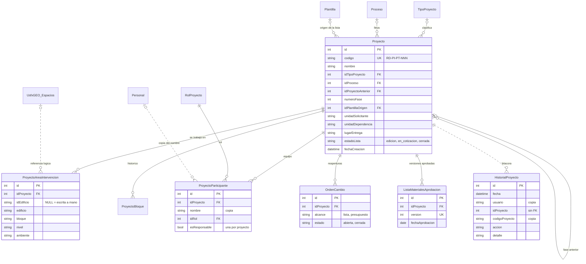
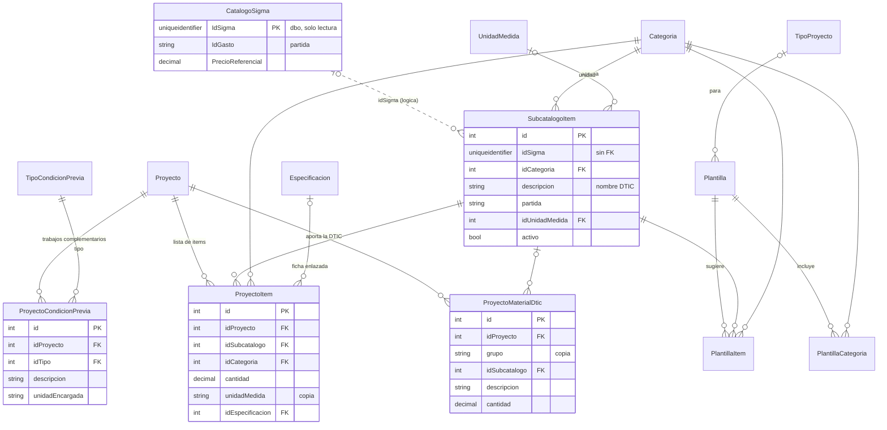
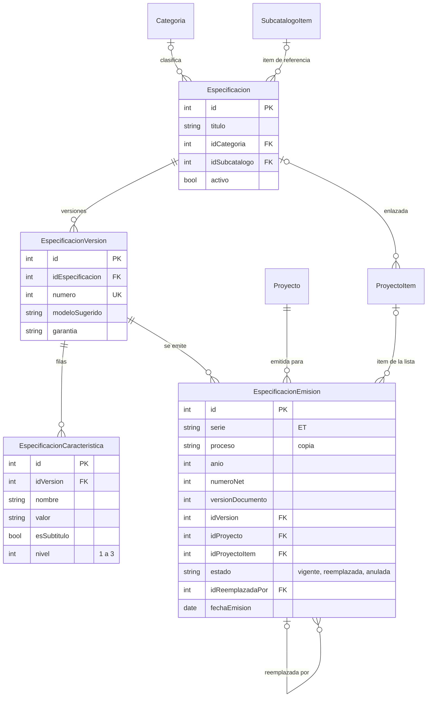
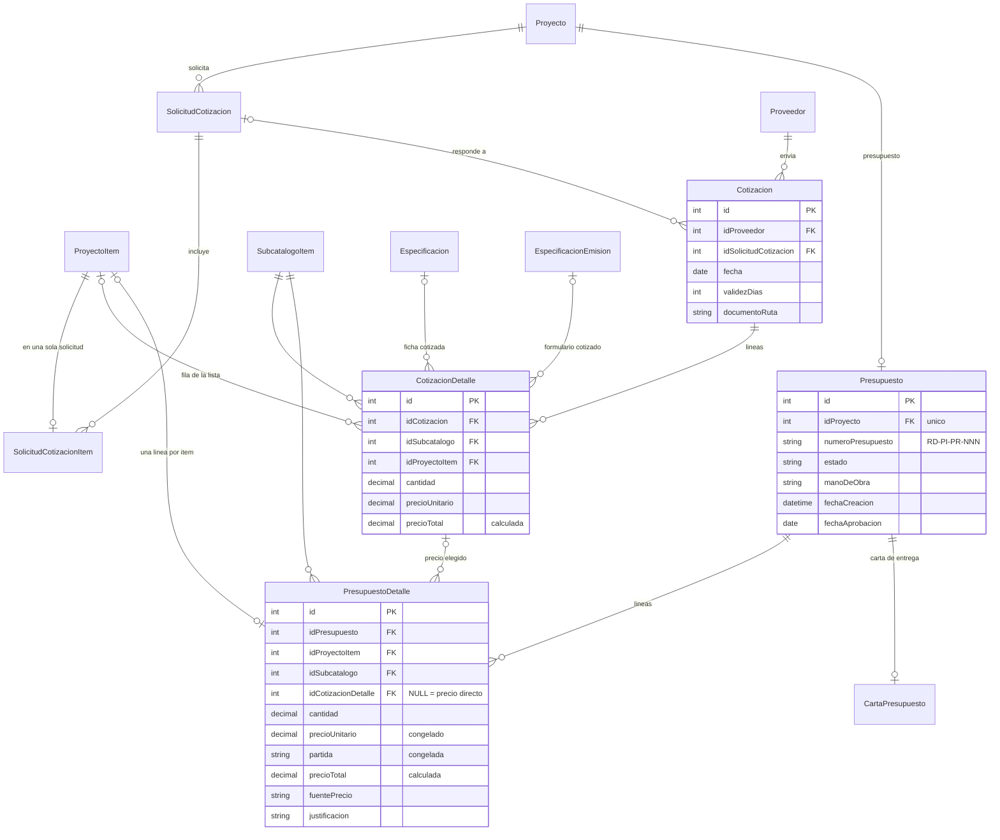
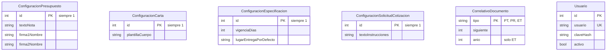

# Modelo lógico de datos

Módulo: Sistema de presupuestos de instalaciones de redes (Unidad de Redes y Telecomunicaciones, DTIC — USFX).
Actualizado: 2 de noviembre de 2026, a partir de la base de desarrollo con todas las migraciones aplicadas
(la última, `m261030_200322_instrucciones_solicitud_de_proforma`).

## 1. Alcance y convenciones

- Base de datos: SQL Server, base `POAPresupuestos`. Todas las tablas propias del módulo están en el
  esquema **`redes`** (39 tablas, más `redes.migration`, que solo registra qué migraciones se aplicaron).
  En `dbo` el módulo **no crea nada**.
- Las tablas se crean y modifican **solo con migraciones de Yii2** (`php yii migrate`), que además cargan
  los datos iniciales que el sistema necesita (catálogos, configuraciones de una sola fila y correlativos).
- Nombres: tablas en PascalCase singular; columnas en camelCase; clave primaria `id` (entera, IDENTITY),
  salvo `CorrelativoDocumento`, cuya clave es `tipo`; claves foráneas `id<Tabla>`.
- Textos en `nvarchar` (Unicode). Montos y cantidades en `decimal(10,2)`. Intercalación de la base de
  desarrollo: `Modern_Spanish_CI_AS`.
- Compatibilidad: probado desde cero con nivel de compatibilidad 110 (SQL Server 2012).

### Referencias a datos externos (lógicas, sin clave foránea)

El módulo **lee** dos fuentes que no son suyas y **no** declara claves foráneas hacia ellas (no puede
modificarlas y podrían estar en otra base):

| Columna del módulo | Apunta a | Uso |
|---|---|---|
| `SubcatalogoItem.idSigma` | `POAPresupuestos.dbo.CatalogoSigma.IdSigma` (solo lectura) | Ítem oficial SIGMA, partida (`IdGasto`) y precio referencial |
| `ProyectoAreaIntervencion.idEdificio`, `idBloqueArea`, `numeroNivel`, `idEspacio` | `UsfxGEO.dbo.Edificios`, `BloquesAreas`, `Niveles`, `Espacios` (solo lectura) | Área de intervención; se guarda además una copia de los nombres |

### Datos congelados y copias

Para que un documento ya emitido o aprobado no cambie cuando cambian los catálogos, varias tablas
guardan **copias** en vez de (o además de) una clave foránea:

- `PresupuestoDetalle`: precio unitario, partida y unidad se copian al crear la línea y no se recalculan.
- `EspecificacionEmision`: título, cantidad, unidad, dependencia, textos, firmas, proceso y año.
- `Presupuesto`, `ListaMaterialesAprobacion`: firmas del control de elaboración, copiadas al aprobar.
- `ProyectoParticipante.nombre`, `ProyectoMaterialDtic.grupo`, `HistorialProyecto.usuario` y
  `codigoProyecto`, `ProyectoItem.unidadMedida`: copias del texto, sin clave foránea.

## 2. Diagramas entidad-relación

Notación (pata de gallo): `||` uno, `o|` cero o uno, `o{` cero o muchos. Línea continua = clave foránea
declarada; línea punteada = referencia lógica sin clave foránea. Los diagramas muestran solo las
claves y algunos atributos; el detalle completo está en el diccionario (sección 4).

### 2.1 Proyecto

### 2.2 Catálogo de ítems, plantillas y lista del proyecto

### 2.3 Especificaciones técnicas

### 2.4 Cotización y presupuesto

### 2.5 Configuración, codificación y usuarios

Tablas sin relaciones con las demás. Las cuatro de configuración tienen **una sola fila** (CHECK `id = 1`).

## 3. Reglas que impone la base de datos

- **Un presupuesto por proyecto** (`Presupuesto.idProyecto` único) y **una línea por ítem de la lista**
  (`PresupuestoDetalle.idProyectoItem` único cuando no es NULL).
- **Un ítem de la lista en una sola solicitud de cotización** (`SolicitudCotizacionItem.idProyectoItem` único).
- **Una sola emisión vigente por ítem** (`EspecificacionEmision.idProyectoItem` único donde
  `estado = 'vigente'`) y un código irrepetible (`serie` + `anio` + `numeroNet` + `versionDocumento`).
- **Una sola persona responsable por proyecto** (`ProyectoParticipante`, único filtrado por
  `esResponsable = 1`), y una persona no repite el mismo rol en el mismo proyecto.
- **Código de proyecto único** cuando existe; código de proceso, nombres de catálogos y nombre de
  usuario, únicos.
- Columnas calculadas: `CotizacionDetalle.precioTotal` y `PresupuestoDetalle.precioTotal`
  (`cantidad * precioUnitario`).
- Borrado en cascada solo para las partes que no existen sin su dueño: las tablas `Proyecto*`,
  `CotizacionDetalle`, `PresupuestoDetalle`, `CartaPresupuesto`, las versiones y características de una
  ficha, y los ítems de plantillas y solicitudes. El presupuesto y las especificaciones emitidas NO se
  borran en cascada con su proyecto (`NO ACTION`): mientras existan, la base rechaza borrar el proyecto.
- Las reglas restantes (estados permitidos, transiciones, qué se puede editar en cada estado) las aplica
  la capa de servicios del sistema (`backend/services`), no la base.

## 4. Diccionario de datos

Generado de la base de desarrollo. "Nulo: sí" = admite NULL.

### 1. Proyecto

#### redes.Proyecto

Proyecto de instalación de redes. Código RD-PI-PT-NNN. Puede ser la fase siguiente de otro (`idProyectoAnterior`). `facultad`, `edificio`, `codigoFacultad` y `codigoEdificio` son datos históricos (ya no se escriben).

| Columna | Tipo | Nulo | Clave / regla |
|---|---|---|---|
| id | int | no | PK |
| codigo | nvarchar(50) | sí |  |
| nombre | nvarchar(300) | no |  |
| facultad | nvarchar(200) | sí |  |
| edificio | nvarchar(200) | sí |  |
| fechaCreacion | datetime | no | por defecto `GETDATE()` |
| descripcion | nvarchar(1000) | sí |  |
| codigoFacultad | nvarchar(30) | sí |  |
| codigoEdificio | nvarchar(30) | sí |  |
| idProyectoAnterior | int | sí | FK → Proyecto.id |
| numeroFase | int | no | por defecto `1` |
| idPlantillaOrigen | int | sí | FK → Plantilla.id |
| listaIniciada | bit | no | por defecto `0` |
| estadoLista | nvarchar(20) | no | por defecto `'edicion'` |
| idTipoProyecto | int | sí | FK → TipoProyecto.id |
| unidadSolicitante | nvarchar(250) | sí |  |
| unidadDependencia | nvarchar(250) | sí |  |
| lugarEntrega | nvarchar(300) | sí | lo copian los formularios de especificación al emitirse; vacío = el de la configuración |
| idProceso | int | sí | FK → Proceso.id |

Único: (codigo) donde ([codigo] IS NOT NULL)

#### redes.TipoProyecto

Catálogo: qué se hace (Ampliación, Mejoramiento, Refuncionalización, Equipamiento).

| Columna | Tipo | Nulo | Clave / regla |
|---|---|---|---|
| id | int | no | PK |
| nombre | nvarchar(100) | no |  |
| activo | bit | no | por defecto `1` |

Único: (nombre)

#### redes.Proceso

Catálogo de procesos del lineamiento RD-GD-LI-001 (GD, DC, PI, DS, GR). Su código va en el código de los documentos.

| Columna | Tipo | Nulo | Clave / regla |
|---|---|---|---|
| id | int | no | PK |
| codigo | nvarchar(2) | no |  |
| nombre | nvarchar(200) | no |  |
| activo | bit | no | por defecto `1` |

Único: (codigo)  
Único: (nombre)

#### redes.ProyectoAreaIntervencion

Dónde se trabaja: edificio → bloque → nivel → ambiente. Guarda los id de UsfxGEO (referencia lógica, sin FK) y una copia congelada de los nombres. `idEdificio` NULL = escrita a mano.

| Columna | Tipo | Nulo | Clave / regla |
|---|---|---|---|
| id | int | no | PK |
| idProyecto | int | no | FK → Proyecto.id (borrado en cascada) |
| orden | int | no | por defecto `0` |
| idEdificio | nvarchar(10) | sí |  |
| edificio | nvarchar(200) | no |  |
| idBloqueArea | int | sí |  |
| bloque | nvarchar(200) | sí |  |
| numeroNivel | nvarchar(10) | sí |  |
| nivel | nvarchar(100) | sí |  |
| idEspacio | nvarchar(10) | sí |  |
| codigoAmbiente | nvarchar(30) | sí |  |
| ambiente | nvarchar(250) | sí |  |

#### redes.ProyectoBloque

Histórico: bloques de los proyectos anteriores al área de intervención. Ya no se escribe.

| Columna | Tipo | Nulo | Clave / regla |
|---|---|---|---|
| id | int | no | PK |
| idProyecto | int | no | FK → Proyecto.id (borrado en cascada) |
| codigo | nvarchar(30) | no |  |
| nombre | nvarchar(100) | no |  |

#### redes.ProyectoParticipante

Equipo del proyecto: copia del nombre de la persona, su rol y si es la responsable (una sola por proyecto).

| Columna | Tipo | Nulo | Clave / regla |
|---|---|---|---|
| id | int | no | PK |
| idProyecto | int | no | FK → Proyecto.id (borrado en cascada) |
| nombre | nvarchar(200) | no |  |
| idRol | int | no | FK → RolProyecto.id |
| esResponsable | bit | no | por defecto `0` |
| orden | int | no | por defecto `0` |

Único: (idProyecto,nombre,idRol)  
Único: (idProyecto) donde ([esResponsable]=(1))

#### redes.Personal

Catálogo de nombres de personas para armar el equipo. Sin FK: el proyecto copia el nombre.

| Columna | Tipo | Nulo | Clave / regla |
|---|---|---|---|
| id | int | no | PK |
| nombre | nvarchar(200) | no |  |
| activo | bit | no | por defecto `1` |

Único: (nombre)

#### redes.RolProyecto

Catálogo de roles dentro del proyecto (Proyectista, Director del proyecto, Supervisor…). No da permisos.

| Columna | Tipo | Nulo | Clave / regla |
|---|---|---|---|
| id | int | no | PK |
| nombre | nvarchar(100) | no |  |
| activo | bit | no | por defecto `1` |

Único: (nombre)

#### redes.OrdenCambio

Registro de por qué se reabrió algo bloqueado. `alcance`: lista | presupuesto; `estado`: abierta | cerrada.

| Columna | Tipo | Nulo | Clave / regla |
|---|---|---|---|
| id | int | no | PK |
| idProyecto | int | no | FK → Proyecto.id (borrado en cascada) |
| alcance | nvarchar(20) | no |  |
| motivo | nvarchar(500) | no |  |
| solicitadoPor | nvarchar(100) | no |  |
| fecha | datetime | no | por defecto `GETDATE()` |
| estado | nvarchar(20) | no | por defecto `'abierta'` |
| fechaCierre | datetime | sí |  |

#### redes.ListaMaterialesAprobacion

Una fila por versión aprobada de la lista de materiales (01, 02…), con copia de las firmas. No se modifica.

| Columna | Tipo | Nulo | Clave / regla |
|---|---|---|---|
| id | int | no | PK |
| idProyecto | int | no | FK → Proyecto.id (borrado en cascada) |
| version | int | no |  |
| fechaAprobacion | date | sí |  |
| usuario | nvarchar(255) | sí |  |
| firma1Prefijo | nvarchar(20) | sí |  |
| firma1Nombre | nvarchar(150) | sí |  |
| firma1Cargo | nvarchar(200) | sí |  |
| firma2Prefijo | nvarchar(20) | sí |  |
| firma2Nombre | nvarchar(150) | sí |  |
| firma2Cargo | nvarchar(200) | sí |  |

Único: (idProyecto,version)

#### redes.HistorialProyecto

Bitácora de cambios del proyecto. Sin FK a Proyecto (guarda `idProyecto` y una copia del código para sobrevivir a su eliminación). No se modifica ni se borra.

| Columna | Tipo | Nulo | Clave / regla |
|---|---|---|---|
| id | int | no | PK |
| fecha | datetime | no |  |
| usuario | nvarchar(100) | sí |  |
| idProyecto | int | no |  |
| codigoProyecto | nvarchar(50) | sí |  |
| accion | nvarchar(40) | no |  |
| estado | nvarchar(20) | sí |  |
| detalle | nvarchar(max) | sí |  |

### 2. Catálogo de ítems, plantillas y lista del proyecto

#### redes.SubcatalogoItem

Subcatálogo curado de ítems de redes (nombre DTIC en mayúsculas). `idSigma` es referencia lógica a `dbo.CatalogoSigma.IdSigma` (sin FK). `partida` copiada de SIGMA o escrita a mano.

| Columna | Tipo | Nulo | Clave / regla |
|---|---|---|---|
| id | int | no | PK |
| idSigma | uniqueidentifier | sí |  |
| idCategoria | int | no | FK → Categoria.id |
| descripcion | nvarchar(300) | no |  |
| activo | bit | no | por defecto `1` |
| fechaRegistro | datetime | no | por defecto `GETDATE()` |
| partida | nchar(5) | sí |  |
| idUnidadMedida | int | sí | FK → UnidadMedida.id |

#### redes.Categoria

Categorías DTIC de los ítems (agrupan la lista y el presupuesto).

| Columna | Tipo | Nulo | Clave / regla |
|---|---|---|---|
| id | int | no | PK |
| nombre | nvarchar(100) | no |  |
| orden | int | no |  |

#### redes.UnidadMedida

Catálogo de unidades de medida (nombre y abreviatura únicos).

| Columna | Tipo | Nulo | Clave / regla |
|---|---|---|---|
| id | int | no | PK |
| nombre | nvarchar(50) | no |  |
| abreviatura | nvarchar(10) | no |  |
| activo | bit | no | por defecto `1` |

Único: (abreviatura)  
Único: (nombre)

#### redes.Plantilla

Plantilla reutilizable de lista de ítems por tipo de proyecto.

| Columna | Tipo | Nulo | Clave / regla |
|---|---|---|---|
| id | int | no | PK |
| nombre | nvarchar(200) | no |  |
| descripcion | nvarchar(500) | sí |  |
| activo | bit | no | por defecto `1` |
| fechaCreacion | datetime | no | por defecto `GETDATE()` |
| idTipoProyecto | int | sí | FK → TipoProyecto.id |

#### redes.PlantillaCategoria

Categorías incluidas en una plantilla y su orden.

| Columna | Tipo | Nulo | Clave / regla |
|---|---|---|---|
| id | int | no | PK |
| idPlantilla | int | no | FK → Plantilla.id (borrado en cascada) |
| idCategoria | int | no | FK → Categoria.id |
| orden | int | no | por defecto `0` |

Único: (idPlantilla,idCategoria)

#### redes.PlantillaItem

Ítems sugeridos de una plantilla con su cantidad sugerida.

| Columna | Tipo | Nulo | Clave / regla |
|---|---|---|---|
| id | int | no | PK |
| idPlantilla | int | no | FK → Plantilla.id (borrado en cascada) |
| idSubcatalogo | int | no | FK → SubcatalogoItem.id |
| idCategoria | int | no | FK → Categoria.id |
| cantidadSugerida | decimal(10,2) | sí |  |
| observacion | nvarchar(300) | sí |  |
| orden | int | no | por defecto `0` |

#### redes.ProyectoItem

Lista de ítems del proyecto (lo que se cotiza y presupuesta). `unidadMedida` es la abreviatura copiada. Puede enlazar una ficha de especificación.

| Columna | Tipo | Nulo | Clave / regla |
|---|---|---|---|
| id | int | no | PK |
| idProyecto | int | no | FK → Proyecto.id (borrado en cascada) |
| idSubcatalogo | int | no | FK → SubcatalogoItem.id |
| idCategoria | int | no | FK → Categoria.id |
| cantidad | decimal(10,2) | no | por defecto `0` |
| unidadMedida | nvarchar(20) | sí |  |
| observacion | nvarchar(300) | sí |  |
| orden | int | no | por defecto `0` |
| idEspecificacion | int | sí | FK → Especificacion.id |

#### redes.ProyectoMaterialDtic

Materiales que aporta la DTIC (sin precio, no van al presupuesto). `grupo` = copia del nombre de la categoría.

| Columna | Tipo | Nulo | Clave / regla |
|---|---|---|---|
| id | int | no | PK |
| idProyecto | int | no | FK → Proyecto.id (borrado en cascada) |
| grupo | nvarchar(150) | no |  |
| idSubcatalogo | int | sí | FK → SubcatalogoItem.id (al borrar: NULL) |
| descripcion | nvarchar(300) | no |  |
| cantidad | decimal(18,2) | no |  |
| unidadMedida | nvarchar(10) | sí |  |
| orden | int | no | por defecto `0` |

#### redes.ProyectoCondicionPrevia

Trabajos complementarios / condiciones previas del proyecto (sin precio).

| Columna | Tipo | Nulo | Clave / regla |
|---|---|---|---|
| id | int | no | PK |
| idProyecto | int | no | FK → Proyecto.id (borrado en cascada) |
| idTipo | int | no | FK → TipoCondicionPrevia.id |
| descripcion | nvarchar(300) | no |  |
| unidadEncargada | nvarchar(150) | sí |  |
| orden | int | no | por defecto `0` |

#### redes.TipoCondicionPrevia

Catálogo de tipos de trabajo complementario.

| Columna | Tipo | Nulo | Clave / regla |
|---|---|---|---|
| id | int | no | PK |
| nombre | nvarchar(150) | no |  |
| activo | bit | no | por defecto `1` |

Único: (nombre)

### 3. Especificaciones técnicas

#### redes.Especificacion

Ficha de la librería: título, categoría, ítem de referencia opcional y activo. No pertenece a un proyecto.

| Columna | Tipo | Nulo | Clave / regla |
|---|---|---|---|
| id | int | no | PK |
| idSubcatalogo | int | sí | FK → SubcatalogoItem.id |
| titulo | nvarchar(300) | sí |  |
| activo | bit | no | por defecto `1` |
| idCategoria | int | sí | FK → Categoria.id |

#### redes.EspecificacionVersion

Versión de una ficha (v1, v2…). Una versión usada en una emisión ya no se modifica.

| Columna | Tipo | Nulo | Clave / regla |
|---|---|---|---|
| id | int | no | PK |
| idEspecificacion | int | no | FK → Especificacion.id (borrado en cascada) |
| numero | int | no |  |
| modeloSugerido | nvarchar(200) | sí |  |
| garantia | nvarchar(500) | sí |  |
| adjuntoRuta | nvarchar(500) | sí |  |
| notaCambio | nvarchar(300) | sí |  |
| fechaCreacion | datetime | no | por defecto `GETDATE()` |

Único: (idEspecificacion,numero)

#### redes.EspecificacionCaracteristica

Filas nombre / valor de una versión. El número de cada fila en el formulario (1.4, 1.4.1, 1.4.1.1) no se guarda: lo calcula `NumeracionEspecificacion` con el orden y el nivel.

| Columna | Tipo | Nulo | Clave / regla |
|---|---|---|---|
| id | int | no | PK |
| idVersion | int | no | FK → EspecificacionVersion.id (borrado en cascada) |
| orden | int | no | por defecto `0` |
| nombre | nvarchar(200) | sí |  |
| valor | nvarchar(max) | no |  |
| esSubtitulo | bit | no | por defecto `0`; fila de un solo texto (sin nombre), en negrita |
| nivel | tinyint | no | por defecto `1`; CHECK entre 1 y 3 |

#### redes.EspecificacionEmision

Formulario emitido (RD-<proceso>-ET-NNN/AA vNN). Copias congeladas de los textos y firmas; estado vigente | reemplazada | anulada. `serie` NET = códigos viejos convertidos.

| Columna | Tipo | Nulo | Clave / regla |
|---|---|---|---|
| id | int | no | PK |
| numeroNet | int | no |  |
| anio | smallint | no |  |
| idVersion | int | no | FK → EspecificacionVersion.id |
| idProyecto | int | no | FK → Proyecto.id |
| idProyectoItem | int | sí | FK → ProyectoItem.id (al borrar: NULL) |
| titulo | nvarchar(300) | no |  |
| cantidad | decimal(10,2) | no |  |
| unidad | nvarchar(20) | sí |  |
| dependencia | nvarchar(200) | sí |  |
| validezOfertaDias | int | sí |  |
| tiempoEntregaDias | int | sí |  |
| lugarEntrega | nvarchar(300) | sí |  |
| elaboradoPor | nvarchar(150) | sí |  |
| textoCabecera | nvarchar(500) | sí |  |
| textoInstrucciones | nvarchar(1000) | sí |  |
| textoNotaFinal | nvarchar(500) | sí |  |
| fechaEmision | date | no |  |
| vigenciaDias | int | no |  |
| estado | nvarchar(20) | no | por defecto `'vigente'` |
| idReemplazadaPor | int | sí | FK → EspecificacionEmision.id |
| motivo | nvarchar(300) | sí |  |
| fechaRegistro | datetime | no | por defecto `GETDATE()` |
| garantia | nvarchar(500) | sí |  |
| serie | nvarchar(3) | no | por defecto `'NET'` |
| codigoAnterior | nvarchar(20) | sí |  |
| firma1Prefijo | nvarchar(20) | sí |  |
| firma1Nombre | nvarchar(150) | sí |  |
| firma1Cargo | nvarchar(200) | sí |  |
| firma2Prefijo | nvarchar(20) | sí |  |
| firma2Nombre | nvarchar(150) | sí |  |
| firma2Cargo | nvarchar(200) | sí |  |
| versionDocumento | int | no | por defecto `1` |
| proceso | nvarchar(2) | no |  |

Único: (idProyectoItem) donde ([estado]='vigente' AND [idProyectoItem] IS NOT NULL)  
Único: (serie,anio,numeroNet,versionDocumento)  
CHECK: `([serie]='ET' OR [serie]='NET')`  
CHECK: `([estado]='anulada' OR [estado]='reemplazada' OR [estado]='vigente')`  
CHECK: `([versionDocumento]>=(1))`

### 4. Cotización y presupuesto

#### redes.Proveedor

Proveedores que cotizan.

| Columna | Tipo | Nulo | Clave / regla |
|---|---|---|---|
| id | int | no | PK |
| razonSocial | nvarchar(200) | no |  |
| nit | nvarchar(50) | sí |  |
| contacto | nvarchar(200) | sí |  |
| telefono | nvarchar(100) | sí |  |
| direccion | nvarchar(300) | sí |  |
| email | nvarchar(200) | sí |  |
| activo | bit | no | por defecto `1` |

#### redes.SolicitudCotizacion

Solicitud de proforma de cotización de un proyecto (número correlativo por proyecto).

| Columna | Tipo | Nulo | Clave / regla |
|---|---|---|---|
| id | int | no | PK |
| idProyecto | int | no | FK → Proyecto.id (borrado en cascada) |
| numero | int | no |  |
| nombre | nvarchar(200) | no |  |
| nota | nvarchar(500) | sí |  |
| fecha | datetime | no | por defecto `GETDATE()` |
| fechaEnvio | date | sí |  |

Único: (idProyecto,numero)

#### redes.SolicitudCotizacionItem

Ítems de la lista incluidos en una solicitud (cada ítem en una sola solicitud) y la marca / modelo de referencia que se pide.

| Columna | Tipo | Nulo | Clave / regla |
|---|---|---|---|
| id | int | no | PK |
| idSolicitud | int | no | FK → SolicitudCotizacion.id (borrado en cascada) |
| idProyectoItem | int | no | FK → ProyectoItem.id |
| marcaModeloReferencia | nvarchar(300) | sí |  |

Único: (idProyectoItem)

#### redes.Cotizacion

Proforma recibida de un proveedor, opcionalmente en respuesta a una solicitud. `documentoRuta` = archivo en `backend/uploads`.

| Columna | Tipo | Nulo | Clave / regla |
|---|---|---|---|
| id | int | no | PK |
| idProveedor | int | no | FK → Proveedor.id |
| numeroReferencia | nvarchar(100) | sí |  |
| fecha | date | sí |  |
| documentoRuta | nvarchar(500) | sí |  |
| validezDias | int | sí |  |
| idSolicitudCotizacion | int | sí | FK → SolicitudCotizacion.id |

#### redes.CotizacionDetalle

Precio ofertado por ítem. `precioTotal` es columna calculada.

| Columna | Tipo | Nulo | Clave / regla |
|---|---|---|---|
| id | int | no | PK |
| idCotizacion | int | no | FK → Cotizacion.id (borrado en cascada) |
| idSubcatalogo | int | no | FK → SubcatalogoItem.id |
| idEspecificacion | int | sí | FK → Especificacion.id |
| marcaModelo | nvarchar(300) | sí |  |
| cantidad | decimal(10,2) | no |  |
| precioUnitario | decimal(10,2) | no |  |
| precioTotal | decimal(10,2) | sí | calculada: `(CONVERT([decimal](10,2),[cantidad]*[precioUnitario]))` |
| idProyectoItem | int | sí | FK → ProyectoItem.id (al borrar: NULL) |
| idEspecificacionEmision | int | sí | FK → EspecificacionEmision.id |

#### redes.Presupuesto

Presupuesto del proyecto (uno por proyecto). Código RD-<proceso>-PR-NNN en `numeroPresupuesto`. Estado en_proceso | en_revision | observado | aprobado | cancelado. Firmas copiadas al aprobar. `fecha` ya no se usa.

| Columna | Tipo | Nulo | Clave / regla |
|---|---|---|---|
| id | int | no | PK |
| idProyecto | int | no | FK → Proyecto.id |
| numeroPresupuesto | nvarchar(20) | sí |  |
| oficioDtic | nvarchar(100) | sí |  |
| areaIntervencion | nvarchar(300) | sí |  |
| estado | nvarchar(20) | no | por defecto `'en_proceso'` |
| fecha | date | sí |  |
| fechaCreacion | datetime | no | por defecto `GETDATE()` |
| manoDeObra | nvarchar(300) | sí |  |
| fechaAprobacion | date | sí |  |
| numeroAnterior | nvarchar(20) | sí |  |
| firma1Prefijo | nvarchar(20) | sí |  |
| firma1Nombre | nvarchar(150) | sí |  |
| firma1Cargo | nvarchar(200) | sí |  |
| firma2Prefijo | nvarchar(20) | sí |  |
| firma2Nombre | nvarchar(150) | sí |  |
| firma2Cargo | nvarchar(200) | sí |  |

Único: (idProyecto)

#### redes.PresupuestoDetalle

Línea del presupuesto: una por ítem de la lista. Precio, partida y unidad CONGELADOS al crear la línea. `precioTotal` calculada. Sin cotización = precio directo (`fuentePrecio`).

| Columna | Tipo | Nulo | Clave / regla |
|---|---|---|---|
| id | int | no | PK |
| idPresupuesto | int | no | FK → Presupuesto.id (borrado en cascada) |
| idSubcatalogo | int | no | FK → SubcatalogoItem.id |
| idCotizacionDetalle | int | sí | FK → CotizacionDetalle.id |
| cantidad | decimal(10,2) | no |  |
| unidadMedida | nvarchar(20) | sí |  |
| precioUnitario | decimal(10,2) | no |  |
| precioTotal | decimal(10,2) | sí | calculada: `(CONVERT([decimal](10,2),[cantidad]*[precioUnitario]))` |
| partida | nchar(5) | sí |  |
| observacion | nvarchar(300) | sí |  |
| idProyectoItem | int | sí | FK → ProyectoItem.id |
| justificacion | nvarchar(300) | sí |  |
| fuentePrecio | nvarchar(200) | sí |  |

Único: (idProyectoItem) donde ([idProyectoItem] IS NOT NULL)

#### redes.CartaPresupuesto

Carta de entrega del presupuesto (0..1 por presupuesto), con su texto y 3 firmas propias.

| Columna | Tipo | Nulo | Clave / regla |
|---|---|---|---|
| id | int | no | PK |
| idPresupuesto | int | no | FK → Presupuesto.id (borrado en cascada) |
| fecha | date | no |  |
| tratamiento | nvarchar(20) | no |  |
| destinatarioNombre | nvarchar(150) | no |  |
| destinatarioCargo | nvarchar(200) | no |  |
| referencia | nvarchar(500) | no |  |
| saludo | nvarchar(150) | sí |  |
| cuerpo | nvarchar(max) | no |  |
| despedida | nvarchar(150) | sí |  |
| firma1Prefijo | nvarchar(20) | sí |  |
| firma1Nombre | nvarchar(150) | sí |  |
| firma1Cargo | nvarchar(200) | sí |  |
| firma2Prefijo | nvarchar(20) | sí |  |
| firma2Nombre | nvarchar(150) | sí |  |
| firma2Cargo | nvarchar(200) | sí |  |
| firma3Prefijo | nvarchar(20) | sí |  |
| firma3Nombre | nvarchar(150) | sí |  |
| firma3Cargo | nvarchar(200) | sí |  |
| copia | nvarchar(200) | sí |  |
| adjunto | nvarchar(300) | sí |  |
| fechaCreacion | datetime | no | por defecto `GETDATE()` |
| fechaModificacion | datetime | sí |  |

Único: (idPresupuesto)

### 5. Configuración, codificación y usuarios

#### redes.ConfiguracionPresupuesto

Una sola fila (CHECK id = 1): nota y firmas del PDF del presupuesto y de la lista de materiales.

| Columna | Tipo | Nulo | Clave / regla |
|---|---|---|---|
| id | int | no | PK |
| textoNota | nvarchar(500) | sí |  |
| firma1Prefijo | nvarchar(20) | sí |  |
| firma1Nombre | nvarchar(150) | sí |  |
| firma1Cargo | nvarchar(200) | sí |  |
| firma2Prefijo | nvarchar(20) | sí |  |
| firma2Nombre | nvarchar(150) | sí |  |
| firma2Cargo | nvarchar(200) | sí |  |

CHECK: `([id]=(1))`

#### redes.ConfiguracionCarta

Una sola fila: textos por defecto y firmas de la carta de entrega.

| Columna | Tipo | Nulo | Clave / regla |
|---|---|---|---|
| id | int | no | PK |
| ciudad | nvarchar(60) | sí |  |
| formatoOficio | nvarchar(100) | sí |  |
| saludo | nvarchar(150) | sí |  |
| plantillaReferencia | nvarchar(500) | sí |  |
| plantillaCuerpo | nvarchar(max) | sí |  |
| despedida | nvarchar(150) | sí |  |
| copia | nvarchar(200) | sí |  |
| plantillaAdjunto | nvarchar(300) | sí |  |
| firma1Prefijo | nvarchar(20) | sí |  |
| firma1Nombre | nvarchar(150) | sí |  |
| firma1Cargo | nvarchar(200) | sí |  |
| firma2Prefijo | nvarchar(20) | sí |  |
| firma2Nombre | nvarchar(150) | sí |  |
| firma2Cargo | nvarchar(200) | sí |  |
| firma3Prefijo | nvarchar(20) | sí |  |
| firma3Nombre | nvarchar(150) | sí |  |
| firma3Cargo | nvarchar(200) | sí |  |

CHECK: `([id]=(1))`

#### redes.ConfiguracionEspecificacion

Una sola fila: textos fijos, plazos y firmas del formulario de especificación.

| Columna | Tipo | Nulo | Clave / regla |
|---|---|---|---|
| id | int | no | PK |
| textoCabecera | nvarchar(500) | sí |  |
| textoInstrucciones | nvarchar(1000) | sí |  |
| garantiaPorDefecto | nvarchar(500) | sí |  |
| textoNotaFinal | nvarchar(500) | sí |  |
| vigenciaDias | int | no | por defecto `30` |
| validezOfertaDias | int | no | por defecto `10` |
| tiempoEntregaDias | int | no | por defecto `5` |
| firma1Prefijo | nvarchar(20) | sí |  |
| firma1Nombre | nvarchar(150) | sí |  |
| firma1Cargo | nvarchar(200) | sí |  |
| firma2Prefijo | nvarchar(20) | sí |  |
| firma2Nombre | nvarchar(150) | sí |  |
| firma2Cargo | nvarchar(200) | sí |  |
| lugarEntregaPorDefecto | nvarchar(300) | sí |  |

CHECK: `([id]=(1))`

#### redes.ConfiguracionSolicitudCotizacion

Una sola fila: textos fijos del PDF de la solicitud de proforma.

| Columna | Tipo | Nulo | Clave / regla |
|---|---|---|---|
| id | int | no | PK |
| textoCabecera | nvarchar(500) | no |  |
| textoInstrucciones | nvarchar(1000) | no |  |
| textoNotaFinal | nvarchar(500) | sí |  |

CHECK: `([id]=(1))`

#### redes.CorrelativoDocumento

Siguiente número de cada tipo de documento: PT, PR, ET. `anio` solo para ET (vuelve a 001 cada año).

| Columna | Tipo | Nulo | Clave / regla |
|---|---|---|---|
| tipo | nvarchar(2) | no | PK |
| siguiente | int | no |  |
| anio | smallint | sí |  |

CHECK: `([tipo]='ET' OR [tipo]='PR' OR [tipo]='PT')`  
CHECK: `([siguiente]>=(1))`

#### redes.Usuario

Usuarios TEMPORALES para ingresar hasta integrar la autenticación institucional. Contraseña cifrada (hash).

| Columna | Tipo | Nulo | Clave / regla |
|---|---|---|---|
| id | int | no | PK |
| usuario | nvarchar(64) | no |  |
| claveHash | nvarchar(255) | no |  |
| authKey | nvarchar(32) | no |  |
| activo | bit | no | por defecto `1` |
| fechaCreacion | datetime | no | por defecto `GETDATE()` |

Único: (usuario)

